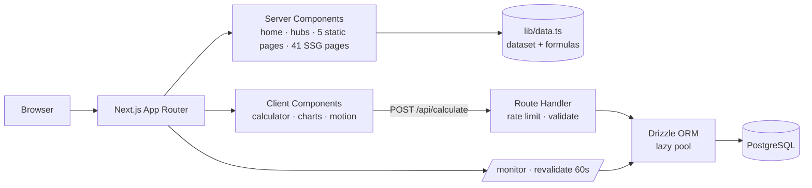

# ytcpm.online — YouTube CPM Calculator

A free, data-driven **YouTube CPM & RPM calculator** built with the Next.js App Router. Estimate what a channel earns per 1,000 views for **23 countries** and **18 niches**, in **local currency**, with separate long-form and Shorts models, seasonality and ad-impression controls — plus 41 statically generated country/niche reference pages and a live usage dashboard.

[](https://github.com/avinashsarraf/ytcpm/actions/workflows/ci.yml)

> **Production domain:** `https://ytcpm.online`
> **Deployment:** see [`deployment.md`](./deployment.md) — Coolify + Docker guide
> **Deep technical audit:** see [`report.md`](./report.md)

---

## Table of contents

- [Features](#features)
- [CMS](#cms)
- [Tech stack](#tech-stack)
- [Architecture](#architecture)
- [Getting started](#getting-started)
- [Environment variables](#environment-variables)
- [Database setup](#database-setup)
- [Available scripts](#available-scripts)
- [Routes](#routes)
- [How the estimate is calculated](#how-the-estimate-is-calculated)
- [API reference](#api-reference)
- [Docker & Coolify](#docker--coolify)
- [Project structure](#project-structure)
- [Data coverage](#data-coverage)
- [Testing](#testing)
- [Known limitations](#known-limitations)
- [Contributing](#contributing)
- [License](#license)

---

## Features

- **Interactive calculator** — monthly views (1K–10M stops), channel niche (S/A/B/C tiers), audience country (Tier 1–4), long-form vs Shorts, **seasonality** (Q1–Q4) and **ad-impression rate**.
- **Local-currency output** — 23 ISO currencies/locales via `Intl.NumberFormat`, with a USD cross-check and an FX note.
- **CPM / RPM breakdown** — CPM range, RPM range, average CPM/RPM, yearly projection, and total estimated earnings.
- **Programmatic SEO pages** — 23 country pages + 18 niche pages, statically generated, each with unique notes, rankings, earnings tables, breadcrumb JSON-LD, FAQs and related links.
- **Trust pages** — methodology (with the full formula), about, contact, privacy, terms.
- **Usage monitor** — `/monitor` aggregates anonymous calculator runs from PostgreSQL (top niches/countries, 14-day volume, recent calculations), cached for 60 s.
- **SEO plumbing** — per-page canonicals + Open Graph, generated sitemap, `robots.txt`, `FAQPage`/`WebApplication`/`BreadcrumbList` JSON-LD, dynamic OG image.
- **Graceful degradation** — the calculator keeps working if PostgreSQL is unavailable; the monitor shows a fallback state and the API reports `logged: false`.
- **Production hardening** — CSP + security headers, rate limiting, request-size caps, lazy DB pool, self-hosted fonts, Docker/Coolify image with migrations on boot.
- **Self-hosted CMS** — a full blog system at `/blog` with an admin at `/cms`: posts, media library, comment moderation, redirects, users, an audit log and a **live SEO panel that blocks publishing** until the page passes the on-page checks.

## CMS

The site ships with its own content system — no third-party service, PostgreSQL only.

| | |
|---|---|
| Admin | `/cms` — dashboard, posts, media, comments, redirects, users, activity, settings |
| Public blog | `/blog`, `/blog/[slug]`, `/blog/tag/[tag]`, `/blog/rss.xml` |
| Storage | `cms_posts`, `cms_revisions`, `cms_media`, `cms_comments`, `cms_redirects`, `cms_users`, `cms_sessions`, `cms_settings`, `cms_activity` |
| Auth | scrypt password hashing, server-side sessions (`HttpOnly` cookie, only the SHA-256 hash stored), rate-limited sign-in, role checks on every action |
| SEO | Per-post SEO title, meta description, focus keyword, keywords, slug, canonical, OG/Twitter image + alt, robots directives, Article/BlogPosting + WebPage + Breadcrumb JSON-LD, publish / schedule / draft states |
| Publish gate | A post cannot go live while a blocking SEO check fails (title, slug, focus keyword, length, headings, image alt text, internal links) |
| Media | Local disk storage with magic-byte validation, 5 MB limit, served from `/media/…` |
| API | `POST /api/cms/posts`, `POST /api/cms/media`, `POST /api/cms/auth/login|logout`, `POST /api/cms/revalidate` (HMAC-signed) |

```bash
npm run db:migrate                        # apply the schema
npm run db:seed-admin -- --email you@ytcpm.online   # create the first admin
```

Full guide: [`docs/cms.md`](./docs/cms.md).

---

## Tech stack

| Layer | Technology |
|---|---|
| Framework | [Next.js 16.4](https://nextjs.org) (App Router, Turbopack, RSC, standalone output) |
| UI | React 19, Tailwind CSS v4 (CSS-first `@theme`), Lucide icons, Framer Motion |
| Language | TypeScript 5.9 (`strict`) |
| Database | PostgreSQL 16 + [Drizzle ORM](https://orm.drizzle.team) (`node-postgres`) |
| Testing | Vitest |
| Tooling | ESLint 9 (flat config), Drizzle Kit, GitHub Actions |
| Fonts | Plus Jakarta Sans (UI + display), JetBrains Mono (data) — **self-hosted** via `next/font/local` |

## Architecture



- **Static-first:** only `/monitor` and the two API routes touch the server at request time.
- **One source of truth:** `src/lib/data.ts` is shared by the browser calculator and the server route, so results cannot drift.
- **Logging never breaks the product:** a failed insert still returns the estimate (`logged: false`).

## Getting started

### Prerequisites

- **Node.js 20.9+** (CI uses 22) and npm 10+
- **PostgreSQL 14+** — optional for the calculator, required for `/monitor` and logging

### 1. Clone and install

```bash
git clone https://github.com/avinashsarraf/ytcpm.git
cd ytcpm
npm install
```

### 2. Configure the environment

```bash
cp .env.example .env
# edit DATABASE_URL if your PostgreSQL differs
```

### 3. Create the database

```bash
createdb app_db
npm run db:push        # or: npm run db:migrate  (applies drizzle/*.sql)
```

### 4. Run

```bash
npm run dev            # http://localhost:3000
```

### 5. Production build

```bash
npm run build          # no DATABASE_URL needed
npm start              # note: with output:"standalone", prefer `node .next/standalone/server.js`
```

> **Fonts are self-hosted**, so builds work offline and behind firewalls — no request to `fonts.googleapis.com`.

## Environment variables

| Variable | Required | Default | Purpose |
|---|---|---|---|
| `DATABASE_URL` | for DB features | — | PostgreSQL connection string |
| `DATABASE_SSL` | No | `false` | Enable TLS (`true` for Neon/Supabase/RDS) |
| `DATABASE_SSL_STRICT` | No | `false` | Verify the server certificate |
| `DATABASE_POOL_MAX` | No | `10` | Pool size per container |
| `DATABASE_STATEMENT_TIMEOUT_MS` | No | `10000` | Per-statement timeout |
| `RUN_MIGRATIONS` | No | `true` | Apply `drizzle/*.sql` on container start |
| `NEXT_TELEMETRY_DISABLED` | No | `1` | Disable Next.js telemetry |
| `PORT` | No | `3000` | Server port |
| `CMS_STORAGE_DIR` | No | `./storage/uploads` | Where the CMS stores uploaded images |
| `CMS_MAX_UPLOAD_BYTES` | No | `5242880` | Maximum upload size |
| `CMS_API_KEY` | No | — | Bearer key for the CMS HTTP API |
| `CMS_REVALIDATE_SECRET` | No | — | HMAC secret for the revalidation webhook |

Templates and the full matrix: [`.env.example`](./.env.example) and [`deployment.md`](./deployment.md#environment-variables).

## Database setup

One table, `calculations`, in [`src/db/schema.ts`](./src/db/schema.ts).

| Column | Type | Notes |
|---|---|---|
| `id` | `serial` | Primary key |
| `views` | `integer` | Monthly views |
| `niche_slug` / `niche_name` | `text` | Selected niche |
| `country_slug` / `country_name` | `text` | Selected country |
| `content_type` | `text` | `long` or `shorts` |
| `season` | `text` | `annual`, `Q1`–`Q4` |
| `monetized_share` | `numeric(4,3)` | Ad-impression rate used |
| `rpm_low` / `rpm_high` | `numeric(10,4)` | Per-1,000-view range |
| `est_low` / `est_high` | `numeric(12,2)` | Monthly estimate range |
| `created_at` | `timestamptz` | Defaults to `now()` |

Indexes: `created_at`, `niche_slug`, `country_slug`, `content_type`.

Schema changes:

```bash
# edit src/db/schema.ts
npm run db:generate    # writes drizzle/000N_*.sql — commit it
```

The Docker entrypoint applies those SQL files exactly once (tracked in `_migrations`).

## Available scripts

| Script | Purpose |
|---|---|
| `npm run dev` | Local development server |
| `npm run build` | Production build (standalone output) |
| `npm start` | Serve the production build |
| `npm run lint` | ESLint |
| `npm run typecheck` | `tsc --noEmit` |
| `npm test` | Vitest unit suite (33 tests) |
| `npm run test:watch` | Vitest in watch mode |
| `npm run db:generate` | Generate a SQL migration from the schema |
| `npm run db:push` | Push the schema directly (dev only) |
| `npm run db:migrate` | Apply the generated SQL migrations to the database |
| `npm run db:studio` | Drizzle Studio |
| `npm run db:seed-admin` | Create the first CMS administrator |
| `npm run test:seo-audit` | Crawl every route and report the full SEO surface |
| `npm run test:cms` | End-to-end CMS test against a throwaway PostgreSQL |

## Routes

| Route | Rendering | Description |
|---|---|---|
| `/` | Static | Hero, calculator, CPM by niche/geography, seasonality, FAQ |
| `/cpm-by-country` | Static | All 23 markets with CPM/RPM and local per-1M earnings |
| `/cpm-by-country/[slug]` | SSG ×23 | Country detail: rank, earnings presets, top niches, FAQs |
| `/cpm-by-niche` | Static | 18 niches ranked by CPM |
| `/cpm-by-niche/[slug]` | SSG ×18 | Niche detail: CPM/RPM, country table, FAQs |
| `/methodology` | Static | Sources, formulas, limitations |
| `/about` · `/contact` · `/privacy` · `/terms` | Static | Trust & legal pages |
| `/monitor` | Server, 60 s cache | Anonymous usage analytics (`noindex`) |
| `/api/calculate` | Dynamic | `POST` estimate (+ optional logging) |
| `/api/health` | Dynamic | DB readiness probe (200/503) |
| `/blog` · `/blog/[slug]` · `/blog/tag/[tag]` | Dynamic | The CMS blog: index, article pages, tag archives |
| `/blog/rss.xml` | Dynamic | The blog feed |
| `/cms/*` | Dynamic | The admin area (session required, `noindex`) |
| `/media/*` | Dynamic | Uploaded images |
| `/api/cms/*` | Dynamic | CMS HTTP API (bearer key) |
| `/sitemap.xml` · `/robots.txt` · `/opengraph-image` · `/icon.svg` | Generated | Crawl + social assets |

## How the estimate is calculated

All benchmarks live in [`src/lib/data.ts`](./src/lib/data.ts) and are quoted in USD.

```ts
countryMultiplier = (countryLow + countryHigh) / (USLow + USHigh);

// Long-form
cpmLow   = niche.cpmLow  × countryMultiplier × seasonMultiplier;
cpmHigh  = niche.cpmHigh × countryMultiplier × seasonMultiplier;
rpmLow   = cpmLow  × 0.55 × adImpressionRate;   // 0.55 = creator share
rpmHigh  = cpmHigh × 0.55 × adImpressionRate;
monthly  = (views / 1000) × rpm;

// Shorts (pooled revenue, no classic CPM)
rpmLow  = 0.02 × countryFactor × nicheTierFactor × seasonMultiplier;
rpmHigh = 0.08 × countryFactor × nicheTierFactor × seasonMultiplier;
// countryFactor = clamp(countryMultiplier, 0.25, 1)
// nicheTierFactor: S 1.25 · A 1.15 · B 1.00 · C 0.85
```

Worked example — **India · Tech & Software · 1,000,000 views/month, full year, 100% ad fill**:

| Metric | Value |
|---|---|
| Country multiplier | 8.61% of US |
| CPM | $0.69–$1.89 |
| RPM | $0.38–$1.04 |
| Monthly estimate | **$378.89–$1,041.94** |

**Assumptions** (full detail on [`/methodology`](./src/app/methodology/page.tsx)):

- Estimates assume a **single-country audience**; real audiences are mixed.
- RPM includes a creator-share (55%) and an **ad-impression rate** you control; the default (100%) is an optimistic upper bound.
- Country scaling is **linear and uniform across niches**.
- Seasonality is opt-in (full year by default); FX rates are indicative and dated.
- Sponsorships, affiliates and memberships are **not** included.

## API reference

### `POST /api/calculate`

```bash
curl -X POST http://localhost:3000/api/calculate \
  -H 'Content-Type: application/json' \
  -d '{"views":100000,"niche":"technology-software","country":"india","type":"long","season":"Q4","monetizedShare":0.7}'
```

```json
{
  "ok": true,
  "logged": true,
  "estimate": {
    "cpmLow": 0.7716,
    "cpmHigh": 2.1218,
    "rpmLow": 0.2971,
    "rpmHigh": 0.8169,
    "monthlyLow": 29.71,
    "monthlyHigh": 81.69,
    "multiplier": 0.0861,
    "season": 1.6,
    "monetizedShare": 0.7
  }
}
```

| Case | Status | Body |
|---|---|---|
| Success, row inserted | `200` | `{ ok, logged: true, estimate }` |
| Success, database unavailable | `200` | `{ ok, logged: false, estimate }` |
| Malformed JSON | `400` | `{ ok: false, error: "Invalid JSON" }` |
| Body > 4 KB | `413` | `{ ok: false, error: "Payload too large" }` |
| Unknown niche/country/season, or views outside 1,000–1,000,000,000 | `422` | `{ ok: false, error: "Invalid input" / "Unknown season" }` |
| Over 60 requests/min (per IP) | `429` | `{ ok: false, error: "Too many requests" }` + `Retry-After` |

### `GET /api/health`

```json
{ "ok": true,  "database": "up" }
{ "ok": false, "database": "down" }
{ "ok": false, "database": "not_configured" }
```

`200` when the database answers, `503` otherwise. Never cached.

## Docker & Coolify

**Full walkthrough:** [`deployment.md`](./deployment.md).

```bash
# Local stack (app + PostgreSQL)
docker compose up -d --build
curl -s localhost:3000/api/health

# Image only
docker build -t ytcpm .
docker run -p 3000:3000 -e DATABASE_URL=postgresql://... ytcpm
```

| Aspect | Implementation |
|---|---|
| Image | Multi-stage, `node:22-alpine`, `output: "standalone"`, non-root `nextjs` (uid 1001) |
| Migrations | `docker-entrypoint.sh` → `scripts/migrate.mjs` (idempotent, `_migrations` table) |
| Healthcheck | `/` (liveness) — use `/api/health` for readiness monitoring |
| Secrets | Never baked into the image (build uses a throwaway URL) |
| Compose | `docker-compose.yml` with `db` (Postgres 16) + `web`, named volume, health-gated startup |

## Project structure

```text
.
├── src/
│   ├── app/
│   │   ├── api/calculate/route.ts     # POST estimate + logging, rate limited
│   │   ├── api/health/route.ts        # DB readiness
│   │   ├── about/ contact/ privacy/ terms/ methodology/
│   │   ├── cpm-by-country/            # index + [slug] SSG pages
│   │   ├── cpm-by-niche/              # index + [slug] SSG pages
│   │   ├── monitor/page.tsx           # cached usage dashboard
│   │   ├── fonts/                     # self-hosted woff2 + OFL licences
│   │   ├── error.tsx · loading.tsx · not-found.tsx
│   │   ├── opengraph-image.tsx        # dynamic social card
│   │   ├── globals.css · layout.tsx · page.tsx · robots.ts · sitemap.ts
│   ├── components/                    # calculator, charts, faq, motion, header, footer
│   ├── db/                            # lazy pool + schema
│   └── lib/                           # data.ts, flags.ts, log.ts, rate-limit.ts, icons
├── drizzle/                           # generated SQL migrations (+ meta)
├── scripts/migrate.mjs                # container migration runner
├── public/site.webmanifest
├── Dockerfile · docker-compose.yml · docker-entrypoint.sh · .dockerignore
├── .github/workflows/ci.yml
├── deployment.md · report.md
└── package.json
```

## Data coverage

| Dimension | Values |
|---|---|
| Countries | **23** — Tier 1 (11), Tier 2 (7), Tier 3 (3), Tier 4 (2) |
| Niches | **18** — S (3), A (5), B (5), C (5) |
| Content types | Long-form, Shorts |
| Seasonality | Q1 0.85×, Q2 0.95×, Q3 1.00×, Q4 1.60× (opt-in) |
| Benchmarks year | 2026 (`DATA_YEAR`), reviewed `DATA_UPDATED_AT` |
| Sitemap URLs | 45 indexable (4 static + 4 trust + 23 countries + 18 niches − overlap) |

## Testing

```bash
npm test             # 422 unit tests
npm run test:cms     # end-to-end CMS test (real database, real browser, 63 checks)
```

Coverage focuses on what can silently break money math:

- dataset invariants (unique slugs, ordered ranges, US anchor, FX sanity)
- `estimateEarnings` for all 23 × 18 combinations (ordering, monotonicity, regression pins)
- seasonality and ad-impression clamping
- Shorts band and niche/country sensitivity
- formatters (`money`, `localMoney`, `viewsLabel`, `fxNote`) across locales
- rate-limiter windows, key isolation and proxy IP parsing

CI (`.github/workflows/ci.yml`) runs lint → typecheck → tests → migrations → build, plus `npm audit` and a Docker image build.

## Known limitations

- Benchmarks are a **manually reviewed 2026 snapshot**, not a live feed. Every range is directional; see [`/methodology`](./src/app/methodology/page.tsx).
- Single-country audiences only; no audience-mix modelling yet.
- Rate limiting is **in-memory** (per container). Use Redis for multi-replica deployments.
- `POST /api/calculate` is unauthenticated by design (public calculator) — protected only by rate limits.
- Contact/privacy pages reference `hello@ytcpm.online`; wire up a real inbox before launch.

## Contributing

1. Fork, branch, `npm install`.
2. Make your change, then run:

   ```bash
   npm run typecheck && npm run lint && npm test && npm run build
   ```

3. Open a pull request. Changes to `src/lib/data.ts` or `estimateEarnings()` must include the source, sample period, and a note — the site publishes financial estimates. Do not add country/niche combinations without unique content.

## License

No license file is present. Until one is added, the source is **all rights reserved** and may not be redistributed. Add a `LICENSE` file (e.g. MIT) if you intend to open-source the project.


## October 2026 audit & UI regression checks

See [AUDIT.md](./AUDIT.md) for fixed issues, validation results and outstanding production gates. Full-bleed backgrounds now use a shared 1600px content grid; long-form calculator assumptions and worldwide defaults are shared, and country flags are self-hosted.

```bash
# Start the app in another terminal, then:
npx playwright install --with-deps chromium
npm run test:ui
# Optional: BASE_URL=http://localhost:3000 SCREENSHOT_DIR=/tmp/ytcpm-screens npm run test:ui
```

The UI smoke test checks seven viewport sizes, key routes, calculator interactions and API error handling. It submits test calculations, so use a local/test deployment rather than an unapproved live database.


## SEO content and report-based CPM/RPM tools

See [SEO_STRATEGY.md](./SEO_STRATEGY.md) for the researched keyword-to-page plan, architecture decision, sources and remaining measurement work. New public static pages include `/youtube-cpm-calculator`, `/youtube-rpm-calculator`, `/guides` and `/sources`. The existing homepage estimates ad earnings; the dedicated tools calculate metrics from matching report inputs. `/monitor` remains API usage analytics, not authenticated YouTube channel monitoring.

`npm run test:seo` checks initial HTML without JavaScript, page-specific metadata, JSON-LD syntax, sitemap coverage, native FAQ disclosures, guide 404 behavior and responsive CPM/RPM tools against a running local server. It uses the same `BASE_URL` / `CHROMIUM_EXECUTABLE_PATH` configuration as the UI smoke test.

No keyword-volume figures, Google ranking, AI recommendation or financial accuracy certification is implied. Official metric sources do not substantiate the directional country/niche model ranges; see the public sources policy before presenting those figures.
